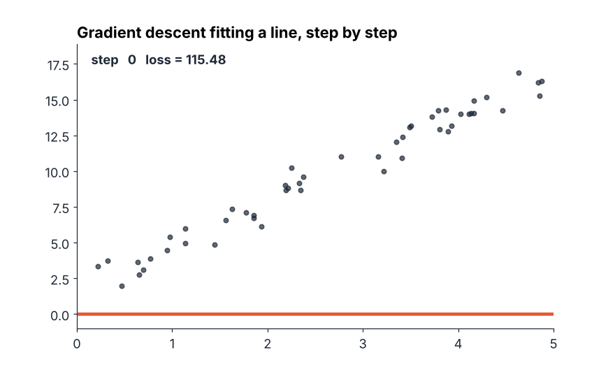
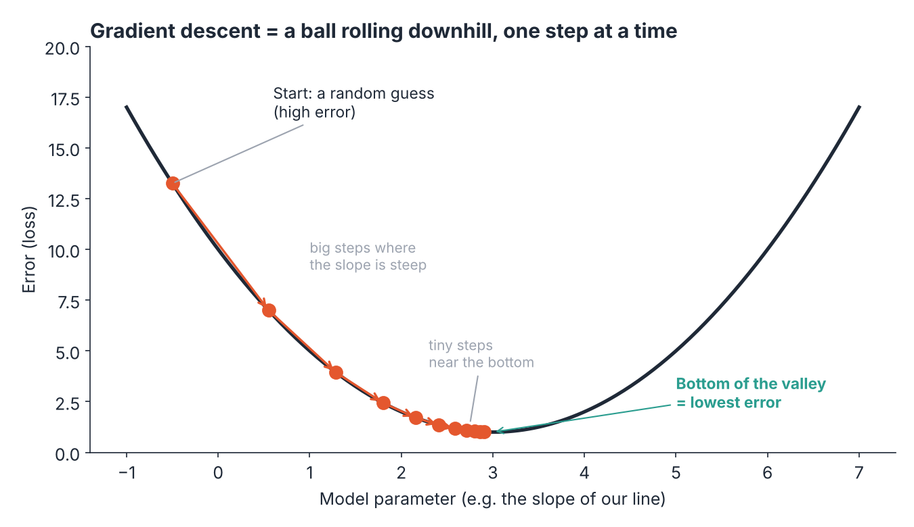
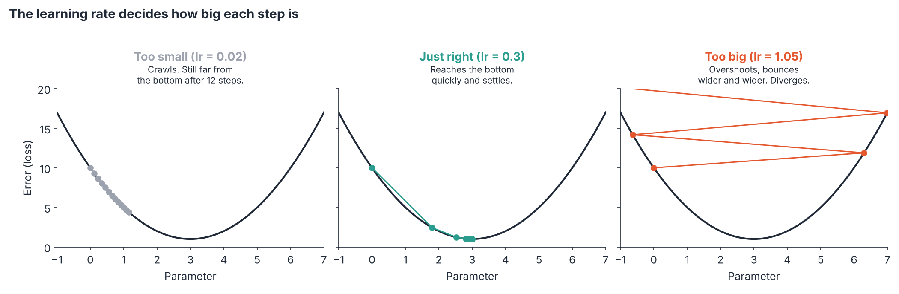
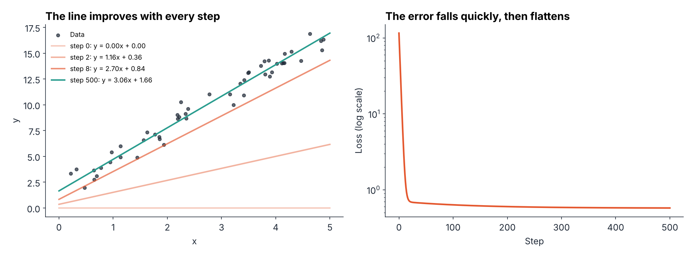

# 01 · Gradient Descent

📖 **Article:** *Every AI You've Ever Used Learned by Rolling Downhill* (add Medium link)



## The idea in one line
**Feel the slope, take a small step downhill, repeat.** That loop is how almost every machine learning model learns.

## What's here

| File | What it does |
|------|--------------|
| `gradient_descent.py` | Gradient descent from scratch in NumPy, fitting `y = w·x + b` |
| `gradient_descent.ipynb` | Step-by-step notebook: data → loss → gradient → training → learning-rate experiments |
| `make_figures.py` | Regenerates every diagram in the article |
| `images/` | The diagrams (PNG + GIF) |

## Run it

```bash
python gradient_descent.py   # prints training progress and the learned line
python make_figures.py       # writes the 4 figures into images/
```

Expected output: the model starts at `y = 0x + 0` and learns approximately **`y = 3.06x + 1.66`** (the true line is `y = 3x + 2`; the gap comes from the noise in the data).

## Try this
- Set `lr=0.15` in `gradient_descent.py` and watch the loss explode.
- Set `lr=0.001` and see how slowly it crawls.
- Start from `w=10, b=-5` and confirm it still finds the same valley.

## Figures

| | |
|---|---|
|  |  |
|  | |

➡️ **Next:** [02 · Overfitting](../02-overfitting)
